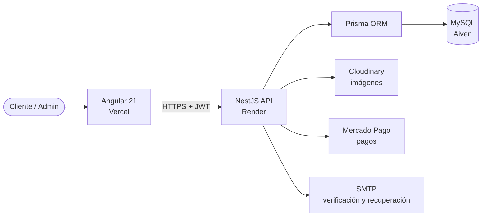

# ⚙️ Tech Store - REST API


Una API RESTful robusta y escalable construida con NestJS y Prisma ORM para gestionar el backend de un e-commerce de tecnología. 

## 🏗️ Arquitectura



Módulos de `src/`: `auth`, `users`, `products`, `categories`, `ordenes`, `payments`, `mail`, `cloudinary`, `prisma`. Validación de entrada con `ValidationPipe` (class-validator) y rutas protegidas por guards de JWT y rol.

## ✨ Funcionalidades (Endpoints)

- **👤 Usuarios & Auth:** Autenticación con JWT (JSON Web Tokens) y encriptación de contraseñas.
- **📦 Gestión de Productos:** CRUD completo de productos y categorías. Subida y manejo de imágenes.
- **🛍️ Órdenes y Ventas:**
  - Creación de órdenes de compra vinculadas a los usuarios.
  - **Gestión inteligente de stock:** El stock se descuenta automáticamente al aprobar una orden y se reintegra si la orden es cancelada por un administrador.
- **🔒 Guards & Roles:** Rutas protegidas para usuarios autenticados y endpoints exclusivos para el rol ADMIN.

## 🗄️ Estructura de la Base de Datos

El proyecto utiliza MySQL (en producción, Aiven). Los modelos principales incluyen:
- `Usuario` (id, nombre, email, password, rol, etc.)
- `Producto` (id, nombre, precio, stockDisponible, categoriaId)
- `Categoria` (id, nombre)
- `Orden` (id, total, estado, fechaOrden, usuarioId)
- `DetalleOrden` (id, ordenId, productoId, cantidad, precio)

## 🚀 Instalación y Configuración Local

1. Clonar el repositorio:
git clone https://github.com/lauJofre04/ecommerce-proyecto-backend.git

2. Instalar las dependencias:
npm install

3. Configurar variables de entorno:
Renombrar el archivo .env.example a .env (asegurate de tener ambos) y configurar la variable DATABASE_URL con tu conexión a MySQL y tu JWT_SECRET.

4. Sincronizar la base de datos con Prisma:
npx prisma db push

5. Iniciar la aplicación:
npm run start:dev

La API estará corriendo en https://ecommerce-proyecto-backend.onrender.com/

## 🌱 Cargar productos de demostración

Con la variable `DATABASE_URL` configurada y la base de datos accesible, ejecutar desde `ecommerce-backend`:

```bash
npm run prisma:seed
```

El seed crea 31 productos tecnológicos distribuidos en cinco categorías, con imágenes y stock de ejemplo. Es seguro ejecutarlo más de una vez: busca cada producto por nombre y omite los que ya existen, sin borrar ni modificar los productos cargados manualmente.

En Render, configurar el **Build Command** así para que el seed se ejecute durante cada deploy:

```bash
npm install --legacy-peer-deps && npm run render:build
```

## 🚧 Notas de Desarrollo
- *Pagos:* el checkout crea la orden y genera una preferencia de pago de Mercado Pago (`payments/create-preference`).

## 🧑‍💻 Autor
**Lautaro Jofré** - *Full-Stack Developer* - [www.linkedin.com/in/lautaro-jofre]
## Despliegue en Render y base de datos

- **Build:** `npm run render:build` genera el cliente de Prisma, aplica las migraciones pendientes (`prisma migrate deploy`) y compila. Ya **no** carga datos de ejemplo en cada deploy.
- **Datos de ejemplo (opcional, a mano):** `npm run prisma:seed` con `DATABASE_URL` apuntando a la base. Es idempotente: no duplica productos.
- **Usuario administrador:**
  ```bash
  ADMIN_EMAIL=admin@ejemplo.com ADMIN_PASSWORD="una-clave-de-12-o-mas-caracteres" npm run create-admin
  ```
  Si el email ya existe, lo promueve a `ADMIN`, lo marca como verificado y cambia su contraseña.
